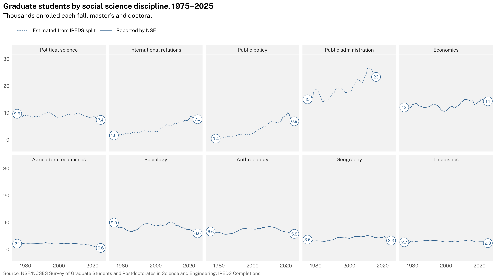

# postgrad-data

Graduate students in each social science discipline, every year from 1972 to 2025. Built from the
unit-level public-use files of NSF/NCSES's
[Survey of Graduate Students and Postdoctorates in Science and Engineering](https://ncses.nsf.gov/surveys/graduate-students-postdoctorates-s-e/2025) (GSS).

Counts are all graduate students (master's + doctoral, full- + part-time) enrolled each fall at U.S. institutions.
Psychology is reported alongside, since NSF treats it as its own broad field.



`R/plot_disciplines.R` draws the figure (`Rscript R/plot_disciplines.R` from the repo root; needs dplyr,
tidyr, readr, ggplot2, ragg and the Public Sans font). Dashed lines are the estimated split of NSF's pre-2017
political science code (see below). Psychology is left out (NSF treats it as its own broad field). Criminology and
criminal justice are left out too: they sat inside "other social sciences" until 2017, and criminology only got
its own code in 2020. All panels share one y axis.

## Outputs (`output/`)

| File | Contents |
|---|---|
| `social_science_grad_students.html` | Formatted year x discipline table with notes on series breaks |
| `social_science_grad_students.xlsx` | Same table, plus master's/doctoral split (2017+) and notes |
| `social_science_grad_students_wide.csv` | Year x discipline, all harmonized columns |
| `social_science_grad_students_long.csv` | Year, field, count |
| `social_science_masters_doctoral_2017on.csv` | Master's and doctoral counts by field, 2017 on (not collected before) |
| `polisci_harmonized.csv` | Harmonized political science series, 1972-2025, with the estimated IR, public policy and public administration pieces before 2017 |
| `polisci_validation_2017on_by_institution.csv` | Institution-level test of the political science split on 2017-2025 |

## Data (`data/`)

| File | Contents |
|---|---|
| `gss_units/gss_units_<decade>.csv` | Unit-level GSS records, 1972-2025: one row per year x school x GSS field code, with institution/school identifiers (incl. IPEDS `unitid`) and graduate student counts by enrollment intensity, sex, first-time status and (2017+) master's/doctoral. Year `2017a` is NSF's broad-field "2017old" bridge file. |
| `gss_totals_by_year_and_code.csv` | Those counts summed by year and GSS field code, all fields |
| `ipeds_completions_polisci_fields.csv` | IPEDS master's and doctoral completions by institution and year, 1980 and 1984-2024, in political science, IR, public policy and public administration |

Race/ethnicity, financial support and postdoc detail are not in `gss_units/`. They are in the raw NSF files:
one zip per year, unmodified, attached to the
[gss-puf-1972-2025 release](https://github.com/thomasjwood/postgrad-data/releases/tag/gss-puf-1972-2025).
`scripts/download_puf.sh` fetches the same files from NSF.

## Validation

For every year 1975-2025, the social sciences and psychology totals match NSF's published trend table
(GSS 2025 table 1-14) exactly.

## Series breaks (read before computing trends)

- **1972-74**: fewer institutions surveyed; NSF's own trend tables start in 1975.
- **2007**: survey redesign and field reclassification (this is NSF's "2007new" series).
- **2014**: survey frame grew by 151 institutions, mostly master's-granting ("2014new").
- **2017**: new taxonomy. Through 2016, code 907 "political science" includes international relations,
  public policy *and public administration*. From 2017, IR and public policy have their own codes, and
  public administration is no longer in the survey. Criminology, criminal justice, area/ethnic/gender and urban
  studies sat in "Other social sciences" (910) before they got their own codes.
- **2020**: area/ethnic/gender studies, criminology and urban studies split out of "Other"; history and
  philosophy of science folded into "Other"; human development moved from social sciences to psychology.

## Harmonized political science

Before 2017 each institution reports one combined count for political science, IR, public policy and public
administration (GSS code 907). `scripts/harmonize_polisci.py` splits it using that institution's IPEDS degree
completions in the four fields (CIP 45.10, 45.09, 44.05, 44.04; HEGIS 2207, 2210, 2102 in 1980):

- weight = 2 x master's + 6 x doctorates (roughly enrolled students per annual graduate), summed over completions
  in the five academic years starting with that fall;
- the institution's 907 count is split in proportion to those weights;
- from 2017 the series is NSF's reported political science count.

The weights and window were chosen by applying the same rule to 2017-2025, where NSF reports political science,
IR and public policy separately, and minimizing institution-level error. Results of that test:

| | 2017 | 2019 | 2021 | 2023 | 2025 |
|---|---|---|---|---|---|
| NSF political science | 8,588 | 8,385 | 8,602 | 7,684 | 7,377 |
| Estimated by the split | 8,384 | 8,546 | 8,934 | 7,478 | 7,421 |

The national estimate is within about 2% on average (worst year 4%). Institution-level errors are larger
(absolute error about 21% of the total) and mostly cancel in the sum. The series also joins up at the break:
2016 estimated 8,621, 2017 reported 8,588.

Caveats: IPEDS has no completions by field for 1981-83, so 1972-83 lean on the 1980 and 1984 files (nearest
available year). HEGIS had no public policy code, so public policy is zero before 1978. The split assumes GSS's 907
units at an institution cover the same programs IPEDS reports for it.

## Reproduce

```bash
bash scripts/download_puf.sh                       # ~460 MB of GSS zips into puf/
bash scripts/download_ipeds.sh                     # ~200 MB of IPEDS zips into ipeds/
python scripts/aggregate_puf.py puf data/gss_totals_by_year_and_code.csv
python scripts/extract_units.py puf data/gss_units
python scripts/extract_ipeds.py ipeds data/ipeds_completions_polisci_fields.csv
python scripts/build_table.py
python scripts/harmonize_polisci.py data/gss_units data/ipeds_completions_polisci_fields.csv
python scripts/render_table.py
```

Requires Python with pandas and openpyxl.
